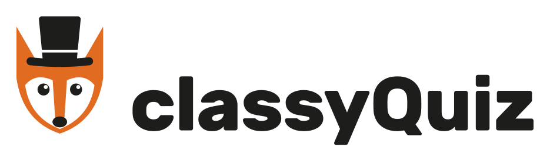
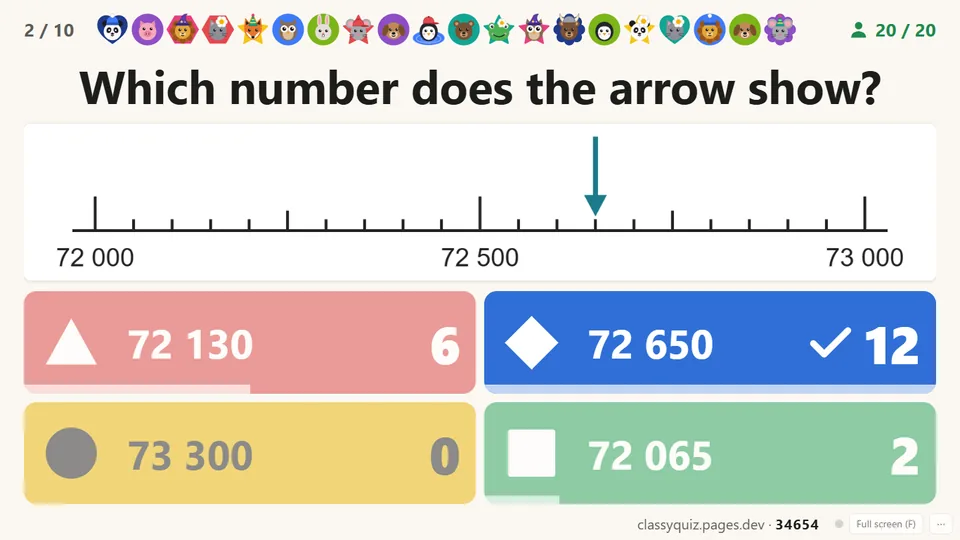
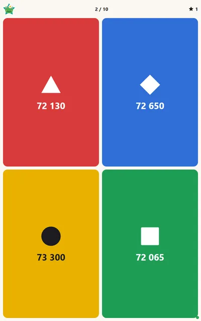
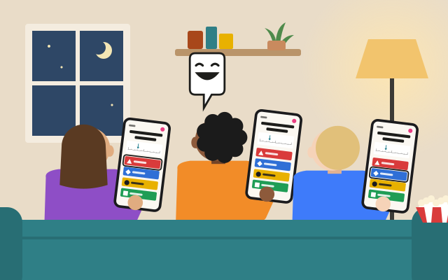

<h1><picture><source media="(prefers-color-scheme: dark)" srcset="src/public/brand/classyquiz-horizontal-colour-dark.svg"></picture></h1>

**Play quizzes your own AI makes**: run by a quizmaster for a class or group on a big screen, among friends on their own devices, or alone. Free, without accounts, nothing to install: **[classyquiz.pages.dev](https://classyquiz.pages.dev)**

<p>


</p>

## Three ways to play

The quiz file is the same for all three; the way is picked after opening it.

|  |  |  |
|---|---|---|
| **Quizmaster**<br>For a class or a group, on a big screen. The question is on the big screen, each player's device shows the choices, and the quizmaster sets the pace. | **Peers**<br>With friends, each on their own device. Nobody runs it: the quiz moves on once everyone present is done, so whoever asked for the quiz plays too. | **Solo**<br>On your own, to practise or review, with the solution after each question. Nothing is uploaded. |

## Get a quiz

Give the AI you already use your material and the site's address:

> Read classyquiz.pages.dev. Can you make me a classyQuiz with exercises like no. 1, 3 and 4 from these two sheets? For my 4th grade class, about 10 questions, in English.

The AI reads the manual on that page and hands back a `.zip`. Any AI subscription will do; otherwise, free Claude: other free options have proven less reliable in testing.

Other ways to ask:

- Nothing decided yet: *"Read classyquiz.pages.dev. I need a classyQuiz. Help?"*
- You will play too: say so, and the AI keeps the questions out of the chat. *"Read classyquiz.pages.dev. Make us a classyQuiz for our games night: 15 questions on films from the 90s, some easy, some hard. I'm playing too, so don't show me the questions."*

## Play it

Open the `.zip` at [classyquiz.pages.dev](https://classyquiz.pages.dev). The site checks it in your browser and offers the three ways to play. In a room, everyone else joins from their own browser with a code.

No quiz yet? The site has an example to play, and [the example, step by step](https://classyquiz.pages.dev/example) shows the conversation with the AI that made it.

## What you can count on

- **Free, without accounts or sign-up.**
- **Nothing kept.** Played on your own, a quiz never leaves your browser. Played in a room, a quiz is deleted when the room is ended, or three hours after its last use. The `.zip` is your lasting copy. No request is logged with an IP address.
- **Built for bad Wi-Fi.** A device that drops comes back into the quiz, and where a network blocks live connections the quiz runs over plain HTTP.
- **Four languages for the site's own words**: English, German, French, Italian. A quiz shows as it was written, in whatever language you asked for.
- **Open.** The code is here, under the MIT licence.

The shared site runs on a free plan, with room for a few dozen quizzes a day between everyone who uses it. Whoever relies on it sets up their own.

## Your own instance

Your own copy runs on a free Cloudflare account, and its quizzes are yours alone. Without the technical part, https://classyquiz.pages.dev/own-copy describes it.

With an AI assistant that runs commands, in a cloud VM (Claude Code on the web) or on your computer: *"Set up my own classyQuiz from https://github.com/sacrusha/ClassyQuiz, following its README."*

**For an AI doing this for someone else:** they create the Cloudflare account and the token (step 3) and choose the name (step 5); everything else is yours. Tell them where to click. The token never goes into the chat: tell them how to hand it over without it (on their own computer, they put it into `secrets/cloudflare.env` themselves; on a cloud VM of yours, whatever way it offers). Where you can run commands, in your VM or on their computer, you run the steps. Where you can't, you explain each step and they run it.

By hand:

1. Install [Node.js](https://nodejs.org) 22.18 or newer (24 recommended) and git, and create a free [Cloudflare account](https://dash.cloudflare.com/sign-up).
2. Get the code and its tools:
   ```
   git clone https://github.com/sacrusha/ClassyQuiz.git
   cd ClassyQuiz/src
   npm install
   ```
3. In the Cloudflare dashboard, create an API token (My Profile → API Tokens → Create Token → Custom token), limited to your account, with the permissions *Account · Workers Scripts · Edit*, *Account · Cloudflare Pages · Edit* and *Account · Account Settings · Read*.
4. Copy `src/cloudflare.env.example` to `secrets/cloudflare.env` and fill in your account ID and the token (details in `secrets/README.md`).
5. In `src/wrangler.toml`, change `name = "classyquiz"` to a name of your own. Your site's address becomes `<name>.pages.dev`, and the start page names it to its users' AIs. If the address turns out different (the name was taken, or you add your own domain), deploy again with `SITE_ADDRESS` set to it in `secrets/cloudflare.env`.
6. In `src/`, run `npm run deploy`. The address is printed at the end.

To try it on your own computer first: `npm run dev` in `src/`, then open http://127.0.0.1:8788.

The shared site's limits for a few users (players per room, the rows a day its uploads may write, storage, what its rooms may book of the day's rows, requests and duration) are constants in `src/shared/limits.ts`; raise them for your own copy. Countdown's length and the points for speed are in `src/shared/tempo.ts`.

A copy changes only when you update it: left as it is, it shows the same screens every time. To update, ask your AI to update it from GitHub, the way it was set up, or `git pull` and `npm run deploy`.

### On a school's or company's own server

A school or company that would rather not use an outside service can run classyQuiz on its own server. The code as published runs on Cloudflare. It is written to be convertible, so that an AI can read it and convert it to another server, and the conversion is theirs. With an AI that runs programs, such as Claude Code: *"Convert classyQuiz from https://github.com/sacrusha/ClassyQuiz to run on our own server, following its README section 'On a school's or company's own server'."*

- **What changes.** The Cloudflare-specific code is the Durable Objects in `src/server/` (`instance.ts`, `directory.ts`, `budget.ts`, `stats.ts`, exported by `worker.ts`: storage, alarms, hibernating WebSockets) and the `/api` routes in `src/functions/api/[[path]].ts`, listed at its top. The game, picture handling, the quiz format (`src/server/game.ts`, `images.ts`, `src/quiz/`, `src/shared/`) and the browser side stay as they are. The browser speaks HTTP and WebSocket to `/api`, with the messages in `src/shared/protocol.ts`.
- **What a converted copy keeps.** A quiz is deleted when it is ended or three hours after its last use (`INSTANCE_IDLE_MS`), and no request is logged with an IP address (`docs/design/hosting-and-limits.md`, "What lives, and for how long"). The limits in `src/shared/limits.ts` are the shared site's; raise them. Serve it over HTTPS: without it, tablets can't keep the screen awake.
- **The guidance the users' AIs read.** Before writing a quiz, a user's AI reads the start page's guidance, at the address the start page names (the Build step). It can't reach an address inside the school's or company's network, and the shared site's guidance moves on with newer versions, whose quizzes an older copy may not read. So the start page has to name an address outside that network that serves the guidance of this copy's own version.
- **Done** when `npm test` passes in `src/` and `node scripts/simulate.mjs <your address>` passes against the converted server: a class of 25 on bad Wi-Fi, checked for answers lost or counted twice.
- **Updates are a choice.** A copy changes only when it is updated, so converting once and leaving it is a way to run it: the same screens every time. To take an update, convert again from the newer code. The Cloudflare-specific code stays in the files above, so converting again stays the same job.

## Working on the code

TypeScript throughout, run by Node as it is and bundled for the browser by esbuild; the pages are plain DOM without a framework. The site is a Cloudflare Pages project (the pages and the `/api` functions) and a Worker holding the Durable Objects that keep a room's state. One runtime dependency, a QR encoder.

In `src/`: `npm run dev` runs the site locally, `npm test` the tests, `npm run check` the type check.

- [`src/DEVELOPING.md`](src/DEVELOPING.md): where things are, running locally, deploying, and the traps.
- [`docs/backlog.md`](docs/backlog.md): what the product is for, what is built and what is open.
- [`docs/design/`](docs/design/): one file per part of the site, its purpose and how the site meets it.

## Licence

[MIT](LICENSE)
